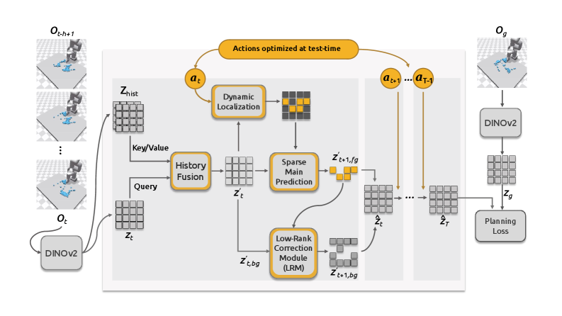

# **DDP-WM**: Disentangled Dynamics Prediction for Efficient World Models
[[Paper]](https://arxiv.org/abs/2602.01780) [[ICML 2026]](https://icml.cc/virtual/2026/poster/62480) [[Poster]](https://icml.cc/media/PosterPDFs/ICML%202026/62480.png) [[Code]](https://github.com/HCPLab-SYSU/DDP-WM) [[Data]](https://osf.io/bmw48/?view_only=a56a296ce3b24cceaf408383a175ce28)

Shicheng Yin, Kaixuan Yin, Weixing Chen, Yang Liu, Guanbin Li and Liang Lin, Sun Yat-sen University



This repository is the official implementation of **DDP-WM (Disentangled Dynamics Prediction World Model)**, a novel framework designed to tackle the efficiency-performance bottleneck in existing world models. We observe that in most physical interaction scenarios, scene evolution can be decomposed into **sparse primary dynamics** driven by physical interactions and **context-driven background updates**.

Unlike dense models such as DINO-WM, DDP-WM employs a four-stage decoupled process for efficient modeling: it identifies foreground changing regions via **dynamic localization**, focuses computational resources on them using a **primary predictor** for high-precision forecasting, and leverages an innovative **Low-Rank Correction Module (LRM)** to update the background at a minimal cost. This design significantly improves computational efficiency while also providing a smoother optimization landscape for the planner, leading to superior planning success rates across various tasks.

## Acknowledgement

Our codebase is refactored and developed upon the excellent [DINO-WM](https://github.com/gaoyuezhou/dino-wm) project. We sincerely thank the authors of DINO-WM for their great work and for open-sourcing their code.

## Project Status

- [x] Core Model Architecture (`DDP_Predictor`, `DDPVWorldModel`)
- [x] Staged Training Script (`train.py`)
- [x] Hydra Configuration Files (`conf/`)
- [x] Planning and Evaluation Scripts (`plan.py`, `planning/`)
- [x] Pre-trained Model Checkpoints (PushT, PointMaze, Wall, Rope, Granular)

## Getting Started

1.  [Installation](#installation)
2.  [Datasets](#datasets)
3.  [Train a DDP-WM Model](#train-a-ddp-wm-model)
4.  [Plan with a DDP-WM Model](#plan-with-a-ddp-wm-model)

## Installation

Our codebase is an extension of the DINO-WM project. For environment setup, including Conda, Mujoco, and the optional PyFlex installation, please follow the comprehensive **[installation guide](https://github.com/gaoyuezhou/dino_wm#installation)** in the official DINO-WM repository.

After setting up the environment, clone this project:
```bash
git clone https://github.com/HCPLab-SYSU/DDP-WM.git
cd DDP-WM
conda activate dino_wm  # Activate the environment you created following the DINO-WM guide
```

## Datasets

The datasets used in this project are the same as those for DINO-WM and can be downloaded from **[here](https://osf.io/bmw48/?view_only=a56a296ce3b24cceaf408383a175ce28)**.

After downloading and unzipping, set an environment variable pointing to your dataset root directory:
```bash
# Replace /path/to/data with the actual path to your dataset folder
export DATASET_DIR=/path/to/data
```
The expected directory structure is as follows:
```
data
├── deformable
│   ├── granular
│   └── rope
├── point_maze
├── pusht_noise
└── wall_single
```

## Train a DDP-WM Model

The training of DDP-WM is conducted in a staged, decoupled manner to ensure stability and reproducibility. You need to train the different components of the model sequentially.
For PushT, each stage trains for 2 epochs with a total batch size of 64. To split it over several GPUs, use `accelerate launch train.py ...` and give `hydra.run.dir` explicitly so that all processes write to the same folder.

### Stage 1: Train the Dynamic Localization Network

This stage trains the **Historical Information Fusion Module** and the **Dynamic Localization Network**.
```bash
python train.py model.training_stage=localization env=pusht frameskip=5 num_hist=3
```
Checkpoints are saved under the `outputs/` directory, which can be configured via `ckpt_base_path` in `conf/train.yaml`.

### Stage 2: Train the Sparse Primary Dynamics Predictor

This stage trains the **Primary Dynamics Predictor**. We freeze the weights from the previous stage and use the generated sparse masks to guide the predictor. You need to specify the checkpoint from Stage 1 via `ckpt_path`.

```bash
python train.py model.training_stage=primary_predictor env=pusht frameskip=5 num_hist=3 ckpt_path=<path_to_stage1_checkpoint.pth>
```

### Stage 3: Train the Low-Rank Correction Module (LRM)

Finally, we train the **LRM** to update the background. In this stage, all modules from the previous two stages are frozen.

```bash
python train.py model.training_stage=lrm env=pusht frameskip=5 num_hist=3 ckpt_path=<path_to_stage2_checkpoint.pth>
```

After these three stages, you will have a fully trained DDP-WM model.

The commands above use PushT; for the other environments replace `env=pusht` with `env=point_maze` or `env=wall`,
or with `env=deformable_env_rope` (Rope) or `env=deformable_env` (Granular) together with `frameskip=1`.
The per-environment model settings are in `conf/motion/`, and the training settings of each released model are in its `hydra.yaml`.

## Plan with a DDP-WM Model

Download the checkpoints from [Hugging Face](https://huggingface.co/yinkx3/ddp-wm) and put them under `checkpoints/outputs/`:
```bash
hf download yinkx3/ddp-wm --local-dir checkpoints/outputs
```
Planning also uses the image decoder of a DINO-WM model to render predicted features (`tools.py`). For PushT, PointMaze
and Wall these are the original DINO-WM checkpoints: download them from the
[DINO-WM release](https://osf.io/bmw48/?view_only=a56a296ce3b24cceaf408383a175ce28) (under `checkpoints`) and rename
their folders to `dinowm_pusht/`, `dinowm_point_maze/` and `dinowm_wall/`. For Rope and Granular, DINO-WM provides no
checkpoints; ours, trained with the DINO-WM code, are included in the Hugging Face release.
```
checkpoints/outputs/
├── ddpwm_pusht/          # DDP-WM (all three stages in one checkpoint) and its training config hydra.yaml
├── ddpwm_point_maze/
├── ddpwm_wall/
├── ddpwm_rope/
├── ddpwm_granular/
├── dinowm_pusht/         # DINO-WM checkpoints (image decoders only used to render predicted features)
├── dinowm_point_maze/
├── dinowm_wall/
├── dinowm_rope/
└── dinowm_granular/
```

Then run from the repository root:
```bash
python plan.py --config-name plan_pusht.yaml
python plan.py --config-name plan_point_maze.yaml
python plan.py --config-name plan_wall.yaml
python plan.py --config-name plan_rope.yaml
python plan.py --config-name plan_granular.yaml
```
Each run evaluates the DDP-WM model with MPC + CEM. The planning settings of each environment, including whether the
Sparse MPC Cost Mask is used, are in its planning config. Results are written to `plan_outputs/`: PushT, PointMaze and
Wall report the success rate, and Rope and Granular the chamfer distance to the goal (the best of the 3 MPC iterations).
To plan with a model you trained, set `model_name` to its run directory under `checkpoints/outputs/`.

PointMaze renders its observations with MuJoCo, which needs extra GPU memory; with `mujoco_py` the rendering can be moved
to another GPU with `GPUS=<id>`. Rope and Granular need PyFleX (see the DINO-WM installation guide). We could not fully
control the randomness of the PyFleX simulation, so their chamfer distances vary between runs.

## Citation

If you find our work useful, please consider citing our paper:
```bibtex
@inproceedings{
yin2026ddpwm,
title={{DDP}-{WM}: Disentangled Dynamics Prediction for Efficient World Models},
author={Shicheng Yin and Kaixuan Yin and Weixing Chen and Yang Liu and Guanbin Li and Liang Lin},
booktitle={Forty-third International Conference on Machine Learning},
year={2026},
url={https://openreview.net/forum?id=gEc0iJCYxw}
}
```